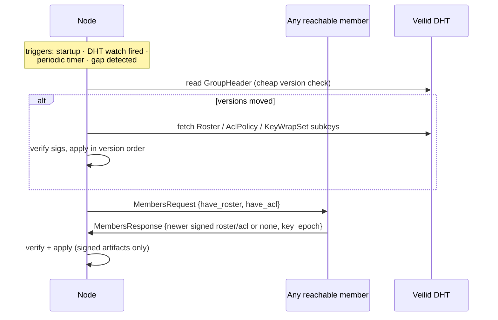
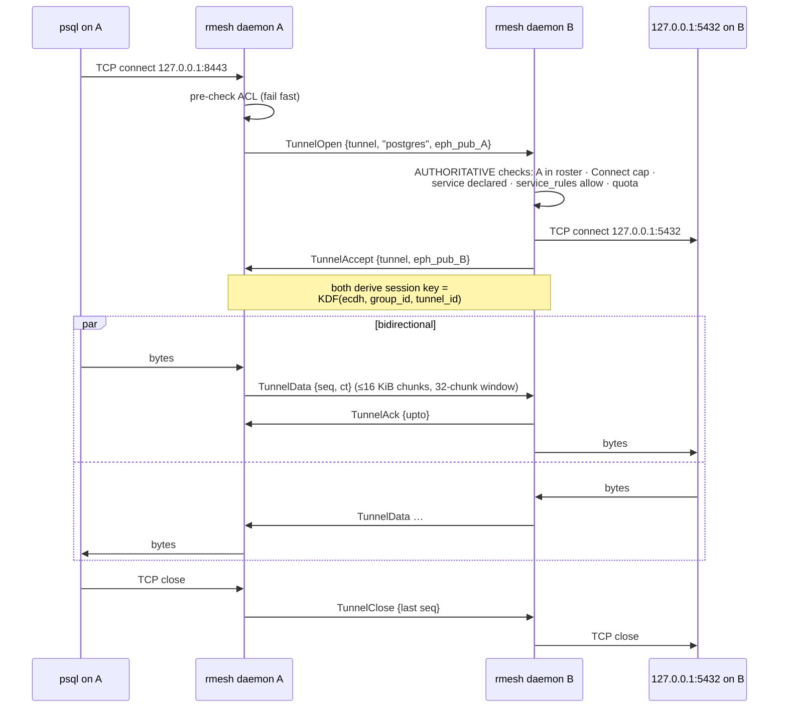

# rmesh POC — Protocol Flows

Schemas in `03-poc-spec.md`. DHT records carry shared state; direct calls
(AppCall/AppMessage over Veilid private routes) carry membership sync and
tunnels.

## 1. Group creation

```mermaid
sequenceDiagram
    participant A as Admin node
    participant D as Veilid DHT
    A->>A: generate group identity + record owner keypairs
    A->>A: generate group key, epoch = 1
    A->>D: create group record; write GroupHeader,<br/>Roster v1 (self, Admin), default AclPolicy v1,<br/>RouteBook v1, KeyWrapSet(epoch 1)
    A->>D: create own presence record, start heartbeat
```

Post-condition: a group of one. The group is only discoverable by knowing
the record key — which travels inside invitation tokens. DHT nodes see an
opaque record whose meaningful subkeys are ciphertext.

## 2. Invitation and join

```mermaid
sequenceDiagram
    participant A as Admin
    participant B as Joining node
    participant D as Veilid DHT
    A->>A: mint Invite {role, nonce, expiry}, sign with group key
    A-->>B: out-of-band: rmesh://invite/… (paste / link / QR)
    B->>B: verify invite sig + expiry; generate keys on first run
    B->>D: create own presence record
    B->>A: JoinRequest {invite, node, dh_pub, presence}
    A->>A: validate voucher (sig, expiry, nonce unredeemed);<br/>envelope sig proves B holds its key
    A->>D: Roster v+1 (append B), KeyWrapSet re-wrapped<br/>for new member set, RouteBook + Header updated
    A->>B: JoinAccept {roster_version}
    B->>D: fetch group record, verify all signatures
    B->>B: unwrap group key, start watches + heartbeat
    B->>A: MembersRequest (initial explicit sync)
```

Failures: expired/duplicate nonce → `JoinReject`; admin unreachable → B
retries while the invite is valid (if the invite's route blob went stale, B
reads the admin's current route from the RouteBook, readable once it knows
the record key and holds... the plaintext header; the RouteBook itself is
group-key-encrypted, so a *first* join always needs the admin's invite
route to still work or a fresh invite).

## 3. Explicit membership sync

Decision #4 from the brainstorm: pull-based explicit sync, no gossip in the
POC.



The direct pull answers the chat's "node A asks node B: who's in this group
right now?" — but the response is the *signed roster*, so a peer can
withhold information, never invent members.

### Liveness (health checks)

- Every member heartbeats its presence record (`seq`, `ts`) every 30 s.
- Peers watching presence mark a member **offline** after 3 missed beats
  (~90 s) — the chat's timeout-detection model. Offline is a routing hint;
  membership is untouched.
- **Voluntary leave**: node sets presence `status = Leaving`, sends
  `Goodbye` to reachable members, stops heartbeating. The admin prunes it
  (roster v+1) and rotates the group key — same machinery as revocation.
- **Rejoin after downtime**: a returning member's first act is flow 3;
  peers see its heartbeat resume and mark it online again.

## 4. Port-forward tunnel (the data plane)

`rmesh expose add postgres 127.0.0.1:5432` on B (declared in B's presence
record). Then on A: `rmesh forward --to B:postgres --listen
127.0.0.1:8443`. No root anywhere.



Either side closes on: TCP close/error, AEAD failure, window protocol
violation, or a roster/ACL change that de-authorizes the tunnel —
**revocation tears down live tunnels**. Private routes hide who is
tunneling to whom, even from relays.

## 5. Revocation and key rotation

```mermaid
sequenceDiagram
    participant A as Admin
    participant D as Veilid DHT
    participant R as Revoked node
    participant M as Remaining members
    A->>D: Roster v+1 (remove R), re-sign
    A->>A: generate group key epoch e+1
    A->>D: KeyWrapSet(e+1) wrapped only for remaining members
    A->>D: GroupHeader {roster v+1, key_epoch e+1}
    D-->>M: watch fires → fetch, verify, unwrap new key
    M->>M: tear down live tunnels with R;<br/>reject its calls (not in roster at v+1)
    Note over R: keeps epoch ≤ e keys (past state)<br/>but cannot read epoch e+1 → forward exclusion
```

Rotation race: members keep current + previous epoch keys briefly so
in-flight control records decrypt; anything older is rejected.

## 6. Route refresh

Contact routes (Veilid private routes) are ephemeral.

1. A member detects its route died → allocates a new one.
2. It updates its own **presence record** (fast path — owner-writable, no
   admin involved) and sends a signed `RouteEntry` to the admin.
3. Admin republishes `RouteBook` v+1 (fallback path for members whose
   presence watch missed it).

`RouteEntry` is signed by the member itself — the admin relays but cannot
substitute routes it controls (anti-MITM property).

## 7. Daemon startup sequence

1. Init transport (attach to Veilid; public bootstrap or configured).
2. Load identity + group state from local store.
3. Per group: read `GroupHeader`; if versions moved → flow 3 (control
   plane first, then data plane).
4. Install DHT watches (group record + members' presence records).
5. Allocate/refresh own route; update presence; start heartbeat.
6. Restore configured `expose` registrations and `forward` listeners.

## Threat notes per flow

| Flow | Main threat | Countermeasure |
|---|---|---|
| Invite | token theft / replay | single-use nonce, expiry, key-possession proof in JoinRequest signature |
| Join | fake admin / fake group | invite carries the group identity key; roster + keywrap must verify against it |
| Sync | forged membership | only group-key-signed rosters accepted; withholding degrades to staleness, surfaced by version diffs between peers |
| Presence | lying about liveness/services | self-signed, affects only routing *to the liar*; never membership |
| Tunnel | unauthorized access to services | destination-side authoritative check: roster + capability + declaration + service rule, default deny |
| Tunnel | eavesdropping by other members | per-tunnel session keys (ECDH of the two endpoints) |
| Tunnel | traffic analysis by relays/observers | Veilid private routes hide endpoints from the path |
| Revocation | revoked node lingers | roster check on every call, live-tunnel teardown, key epoch rotation |
| Routing | admin MITM via forged routes | route blobs signed by their owners |
