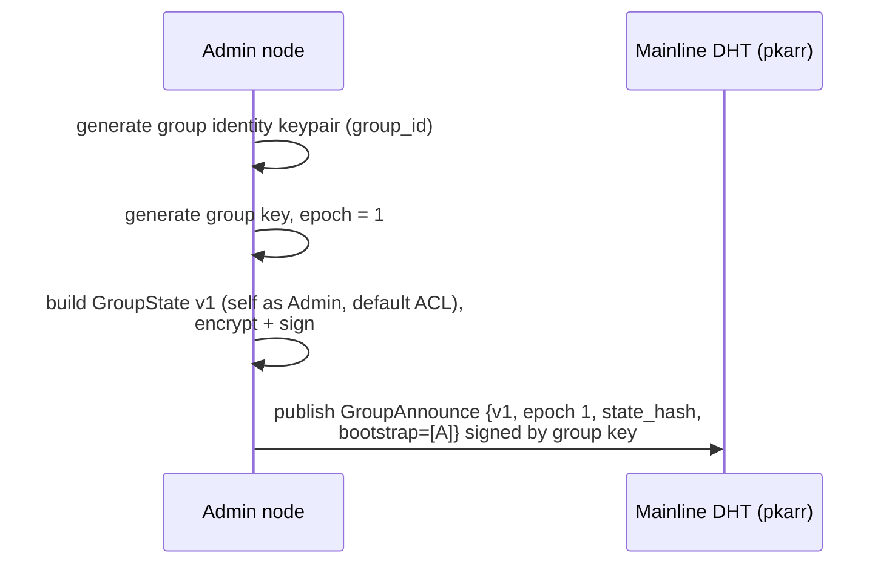
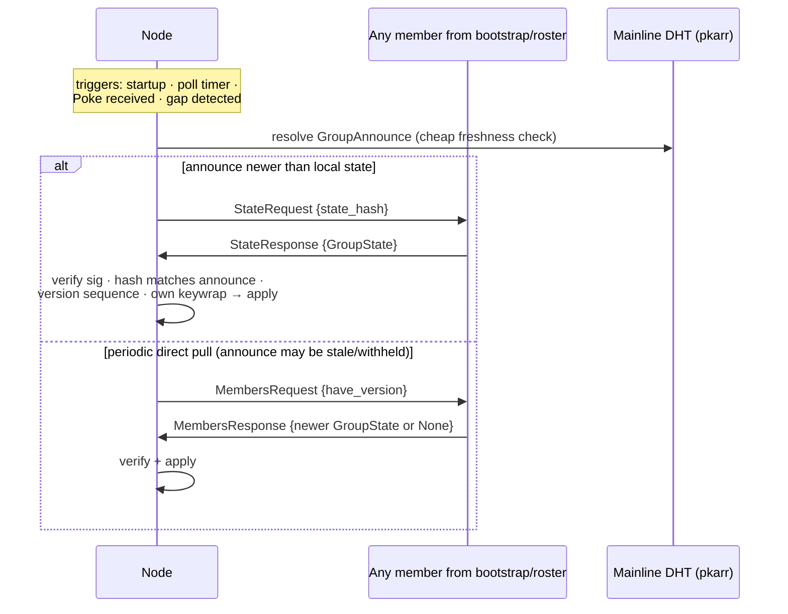
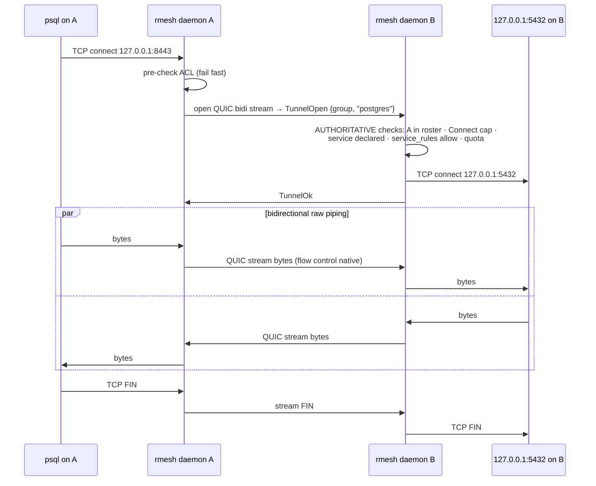

# rmesh POC — Protocol Flows

Schemas in `03-poc-spec.md`. The mainline DHT (via pkarr) carries the tiny
signed group announce; everything else is direct QUIC between members
(ALPN `rmesh/0`), with iroh resolving EndpointIds to addresses.

## 1. Group creation



Post-condition: a group of one. The DHT learns only that an announce exists
under an opaque key; roster and policy are ciphertext held by members.

## 2. Invitation and join

```mermaid
sequenceDiagram
    participant A as Admin
    participant B as Joining node
    participant D as Mainline DHT (pkarr)
    A->>A: mint Invite {role, nonce, expiry}, sign with group key
    A-->>B: out-of-band: rmesh://invite/… (paste / link / QR)
    B->>B: verify invite sig + expiry; generate keys on first run
    B->>A: dial admin EndpointId (iroh discovery) →<br/>JoinRequest {invite, node, dh_pub}
    Note over A,B: QUIC handshake already proves B holds `node`
    A->>A: validate voucher (sig, expiry, nonce unredeemed)
    A->>A: GroupState v+1 (append B), key re-wrapped<br/>for new member set, re-encrypt, re-sign
    A->>B: JoinAccept {GroupState v+1}
    A->>D: republish GroupAnnounce {v+1}
    A->>M: Poke {v+1} to reachable members
    B->>B: verify state sig + own keywrap, unwrap group key
    B->>B: start announce refresh + heartbeats
```

Failures: expired/duplicate nonce → `JoinReject`; admin unreachable → B
retries while the invite is valid (iroh discovery keeps resolving the
admin's current addresses — no stale-route problem).

## 3. Explicit membership sync

Decision #4: pull-based explicit sync, no gossip in the POC.



The direct pull is the chat's "node A asks node B: who's in this group right
now?" — but the answer is the *signed, encrypted state*, so a peer can
withhold news, never invent members.

### Liveness (health checks)

- Members send `Presence {seq, ts, services}` to reachable peers every 30 s.
- A member is marked **offline** after 3 missed beats (~90 s) — the chat's
  timeout-detection model. Offline is a routing hint; membership untouched.
- **Voluntary leave**: `Presence{status: Leaving}` + `Goodbye`; the admin
  prunes (state v+1, key rotation) — same machinery as revocation.
- **Rejoin after downtime**: first act is flow 3; peers see heartbeats
  resume.

## 4. Port-forward tunnel (the data plane)

`rmesh expose add postgres 127.0.0.1:5432` on B. Then on A:
`rmesh forward --to B:postgres --listen 127.0.0.1:8443`. No root anywhere.



Either side resets the stream on: TCP error, protocol violation, or a
roster/ACL change that de-authorizes the tunnel — **revocation tears down
live tunnels**. iroh gives direct paths when hole punching succeeds and
relay fallback otherwise; relays see only QUIC ciphertext.

## 5. Revocation and key rotation

```mermaid
sequenceDiagram
    participant A as Admin
    participant D as Mainline DHT (pkarr)
    participant R as Revoked node
    participant M as Remaining members
    A->>A: GroupState v+1 (remove R) · group key epoch e+1 ·<br/>keywraps only for remaining members
    A->>D: republish GroupAnnounce {v+1, epoch e+1}
    A->>M: Poke {v+1}
    M->>A: StateRequest → verify → apply
    M->>M: tear down live tunnels with R;<br/>reject R's streams (not in roster at v+1)
    Note over R: R holds epoch ≤ e keys (past state) but has no<br/>keywrap for e+1 → cannot read new state: forward exclusion
```

Rotation race: members keep current + previous epoch keys briefly so
in-flight state fetches decrypt; older epochs are rejected.

## 6. Announce upkeep

Mainline/pkarr records expire, so:

1. The admin republishes the current announce every 60 min (same bytes,
   same group-key signature).
2. Bootstrap members cache the latest signed announce and republish it on
   the same timer — valid because pkarr accepts the record from anyone (the
   signature is the authority). The group stays joinable/syncable while the
   admin is offline; only *changes* require the admin (POC single-admin
   limitation, tracked in the roadmap).

## 7. Daemon startup sequence

1. Load identity + group state from local store; bring up the iroh endpoint
   (discovery: pkarr/DNS, mDNS for LAN).
2. Per group: resolve announce → flow 3 (control plane first).
3. Start heartbeats; restore `expose` registrations and `forward`
   listeners.
4. If admin: resume announce republish timer + nonce table.

## Threat notes per flow

| Flow | Main threat | Countermeasure |
|---|---|---|
| Invite | token theft / replay | single-use nonce, expiry, channel-bound key possession at redemption |
| Join | fake admin / fake group | invite pins `group_id`; state must verify against that key; joiner's keywrap must be present |
| Sync | forged membership | only group-key-signed state accepted; withholding degrades to staleness, surfaced by version diffs between peers and the announce |
| Announce | rollback / withholding | version monotonicity vs. local state; direct pull path doesn't depend on the DHT |
| Presence | lying about liveness/services | affects only routing to the liar; never membership |
| Tunnel | unauthorized service access | destination-side authoritative check (roster + capability + declaration + rule), default deny |
| Tunnel | eavesdropping | E2E QUIC between the two members' keys; relays see ciphertext |
| Revocation | revoked node lingers | roster check per stream, live teardown, key epoch rotation |
