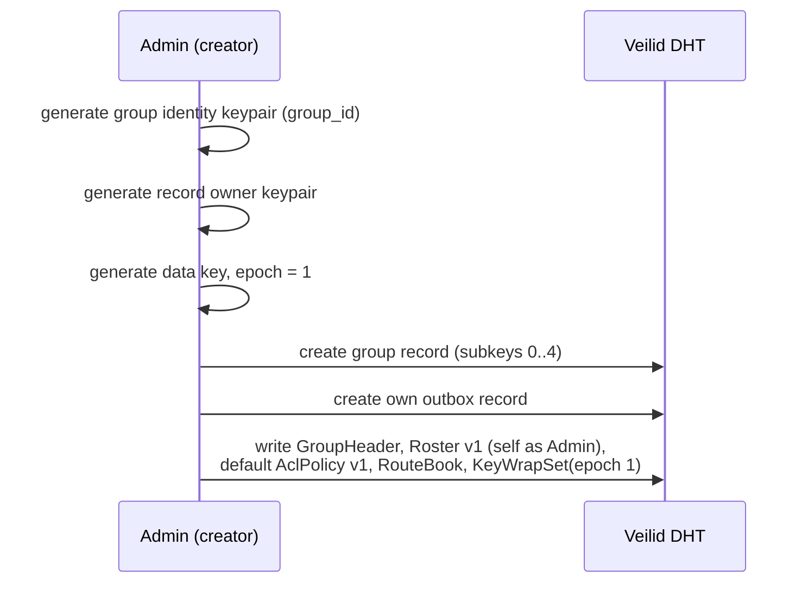
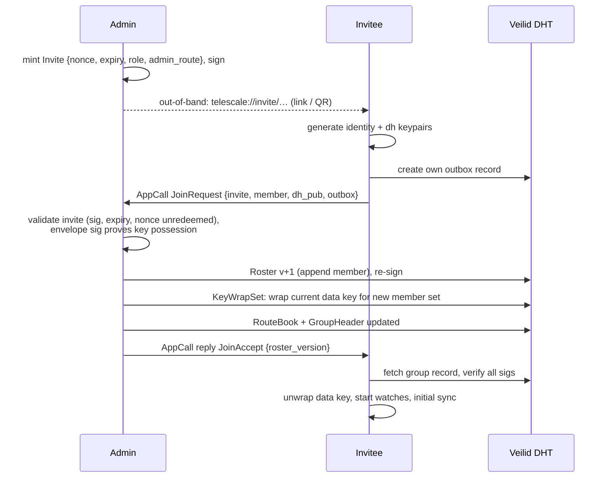
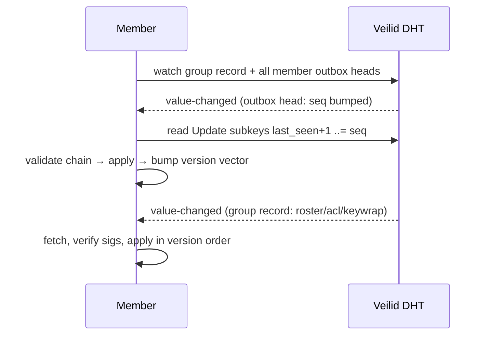
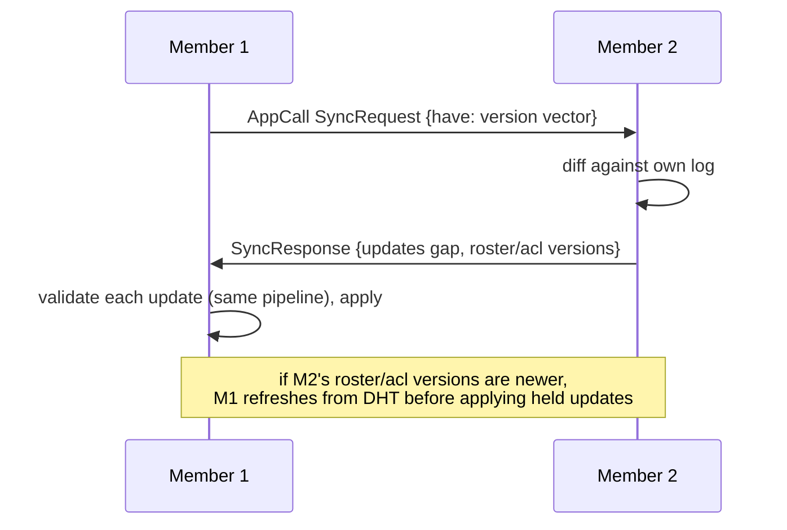
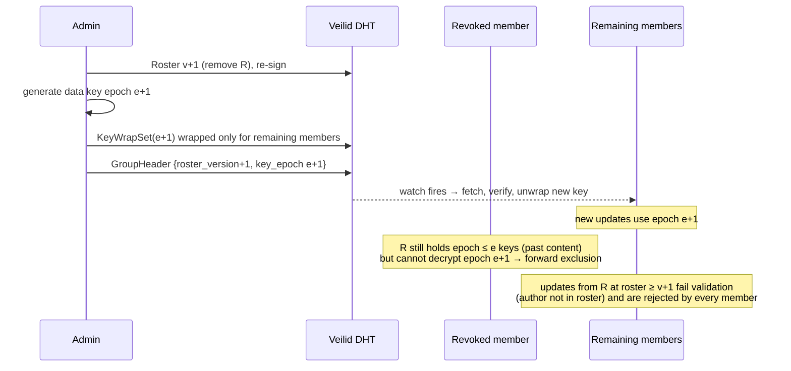

# Telescale POC — Protocol Flows

Message and record schemas are in `03-poc-spec.md`. All flows below run over
Veilid: DHT operations for shared state, AppCall/AppMessage over private
routes for direct interaction.

## 1. Group creation

Post-condition: a group of one. The group is *only* discoverable by knowing
the group record key — which travels inside invites.

## 2. Invitation and join

Failure paths: expired/duplicate nonce → `JoinReject`; admin unreachable →
invitee retries while invite valid (route blob in the invite may go stale —
invitee falls back to fetching the admin's current route from the RouteBook
subkey, which is readable once they know the record key).

## 3. Explicit sync

Two complementary paths; both end in the same validation pipeline
(`03-poc-spec.md` § validation rules).

### 3a. DHT watch path (background convergence)

### 3b. Direct reconcile path (fast / gap recovery)

Used on startup, when the watch path reports a gap larger than the outbox
ring buffer (N=64), or opportunistically after sending.

Sender nudge: after writing an update, a member fire-and-forgets a `Poke`
AppMessage to members with fresh RouteBook entries — cuts perceived latency
below DHT watch latency, but is purely an optimization; correctness never
depends on pokes arriving.

## 4. Sending application data

1. Author builds `Payload` (Chat/KvPut/…), encrypts with current data key →
   `EncPayload`.
2. Wraps in `Update {seq = own_seq+1, prev_hash, roster_version, key_epoch}`,
   signs.
3. Writes to own outbox subkey `1 + (seq % 64)`, then updates `OutboxHead`.
4. Sends `Poke` to reachable members.

Receivers validate + apply per the normative rules. The demo CLI renders
`Chat` as a chat timeline and `KvPut/KvDel` as a live key-value document.

## 5. Revocation and key rotation

Rotation race handling: members accept payloads at epoch `e` for a grace
window (current + previous epoch) so in-flight updates aren't lost; anything
older is rejected.

Voluntary leave: member writes `Tombstone` as their final update; admin then
runs the same revocation flow.

## 6. Route refresh

Private routes are ephemeral — Veilid can drop/rotate them.

1. Member detects its route died (Veilid callback) → allocates a new one.
2. Member sends signed `RouteEntry` to admin (AppCall; falls back to writing
   a poke via any reachable member if the admin route is also stale).
3. Admin republishes `RouteBook` v+1.

Because `RouteEntry` is signed by the member, the admin relays but cannot
forge routes (prevents an admin silently MITM-ing member↔member traffic by
substituting routes it controls).

## 7. Startup sequence (every node)

1. Init veilid-core, attach to network (public bootstrap or configured).
2. Load identity + group state from TableStore.
3. For each group: fetch `GroupHeader`; if versions moved, sync roster/ACL/
   keywrap first (state plane before data plane).
4. Install DHT watches; run one 3b reconcile against any reachable member.
5. Allocate/refresh private route; publish `RouteEntry` if changed.

## Threat notes per flow

| Flow | Main threat | Countermeasure |
|---|---|---|
| Invite | token theft/replay | single-use nonce, expiry, key-possession proof in JoinRequest |
| Join | fake admin | invite + roster + keywrap all signed by group identity key the invitee got out-of-band inside the invite |
| Sync | forged/withheld updates | signatures + hash chain + per-author seq; withholding degrades to availability, detected by cross-peer version-vector diffs |
| Send | unauthorized writer | ACL check against roster at declared version, on every member |
| Revocation | revoked member re-injects | roster check fails at v+1; new epoch key unavailable |
| Routing | admin substitutes routes | RouteEntry signed by the member itself |
